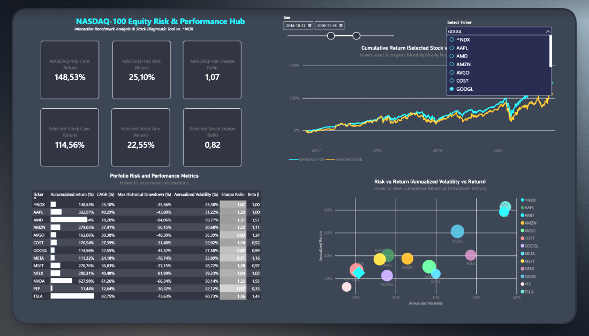
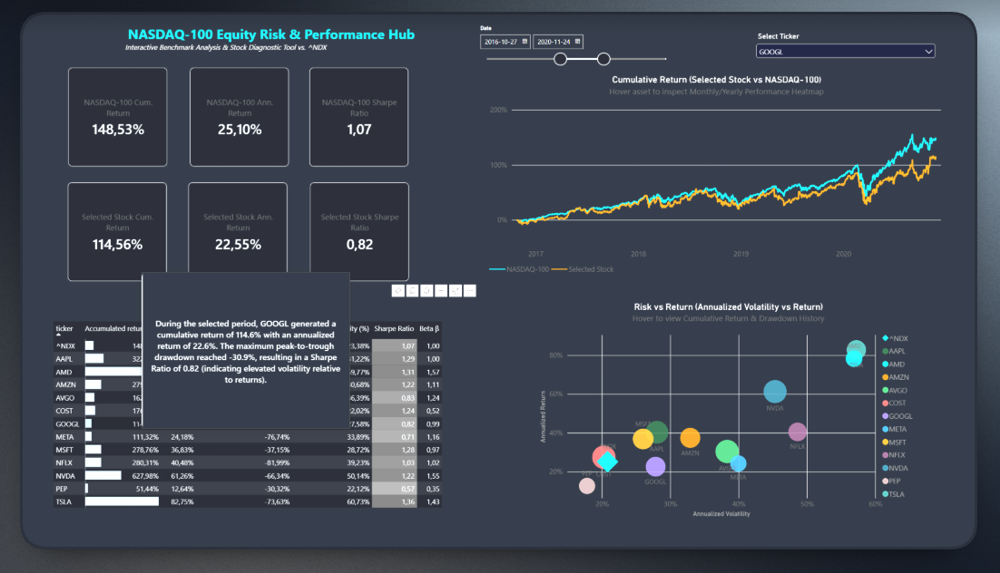
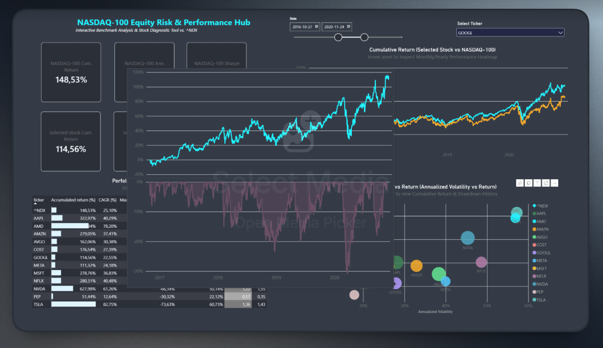
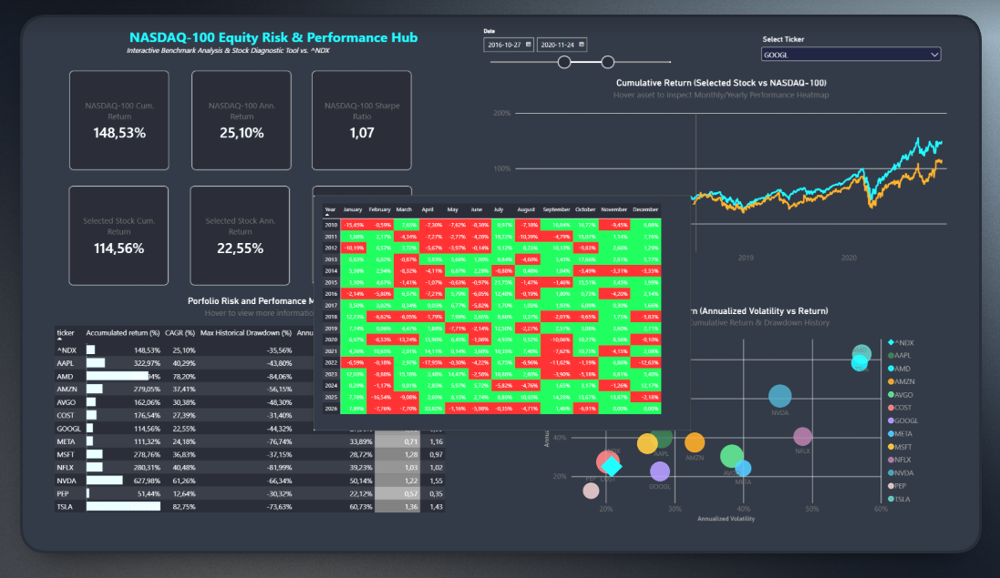

# 📈 NASDAQ-100 Performance Hub

An interactive Power BI dashboard for analyzing NASDAQ-100 stocks against the ^NDX benchmark. Designed with a dark "Financial Terminal" UI for clear risk and performance diagnostics.
https://app.powerbi.com/groups/me/reports/df608ba6-6ac5-4a29-9b73-5582e80ada5a/2069203790621a4b054a?experience=power-bi

## 📸 Dashboard Gallery

| Main Command Center | Risk vs Return Matrix |
| :---: | :---: |
|  |  |
| **Drawdown Profile Tooltip** | **Monthly Heatmap Tooltip** |
|  |  |

## 🌟 Key Features
* **Terminal UI:** A clean, dark-mode interface minimizing visual noise.
* **Smart Tooltips:** Hovering over charts reveals dynamic historical drawdowns and monthly return matrices.
* **Risk Diagnostics:** Scatter plot comparing annualized volatility and returns across the index.
* **Context-Aware DAX:** Custom measures overriding standard date filters for complete historical context.

## 🛠️ Built With
* **Power BI & DAX:** Dashboard architecture and dynamic calculations (e.g., dynamic Peak-to-Trough Drawdown).
* **Python:** Initial data preparation and quantitative metric validation (Pandas, NumPy).

## 🚀 How to Explore
1. Clone or download this repository.
2. Open `NASDAQ100_Performance_Hub.pbix` in Power BI Desktop.
3. Select a ticker from the top dropdown and adjust the date slider.
4. Hover over data points to trigger the diagnostic tooltips.

## 🧠 Advanced DAX Implementation
*Note: The dashboard is powered by over 20 custom DAX measures. The examples below highlight advanced patterns used for geometric compounding and rolling window evaluations over dynamic timeframes.*

**1. Dynamic Geometric Compounding (Cumulative Return)**  
Since DAX lacks a native product aggregation function, this measure calculates the exact compounded return over the selected period using the mathematical property of natural logarithms and exponentials:
```dax
d_cumulative_return_selected_stock = 
VAR StartDate = CALCULATE(MIN('calendar'[Date]), ALLSELECTED('calendar'[Date]))
VAR CurrentDate = MAX('calendar'[Date])
RETURN 
    CALCULATE(
        EXP(
            SUMX(
                daily_return,
                LN(1 + daily_return[Value])
            )   
        ) - 1,
        'calendar'[Date] >= StartDate && 'calendar'[Date] <= CurrentDate
    )

```

```
d_drawdown = 
VAR CurrentDate = MAX('calendar'[Date])
VAR CurrentPrice = SUM(prices[Value]) 

VAR MaxPriceToDate = 
    CALCULATE(
        MAX(prices[Value]),
        FILTER(
            ALLSELECTED('calendar'[Date]),
            'calendar'[Date] <= CurrentDate
        )
    )

RETURN
    IF(
        ISBLANK(CurrentPrice),
        BLANK(),
        DIVIDE(CurrentPrice - MaxPriceToDate, MaxPriceToDate, 0)
    )